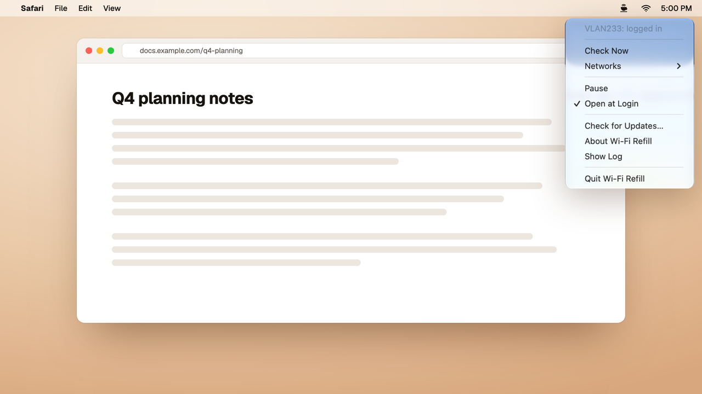
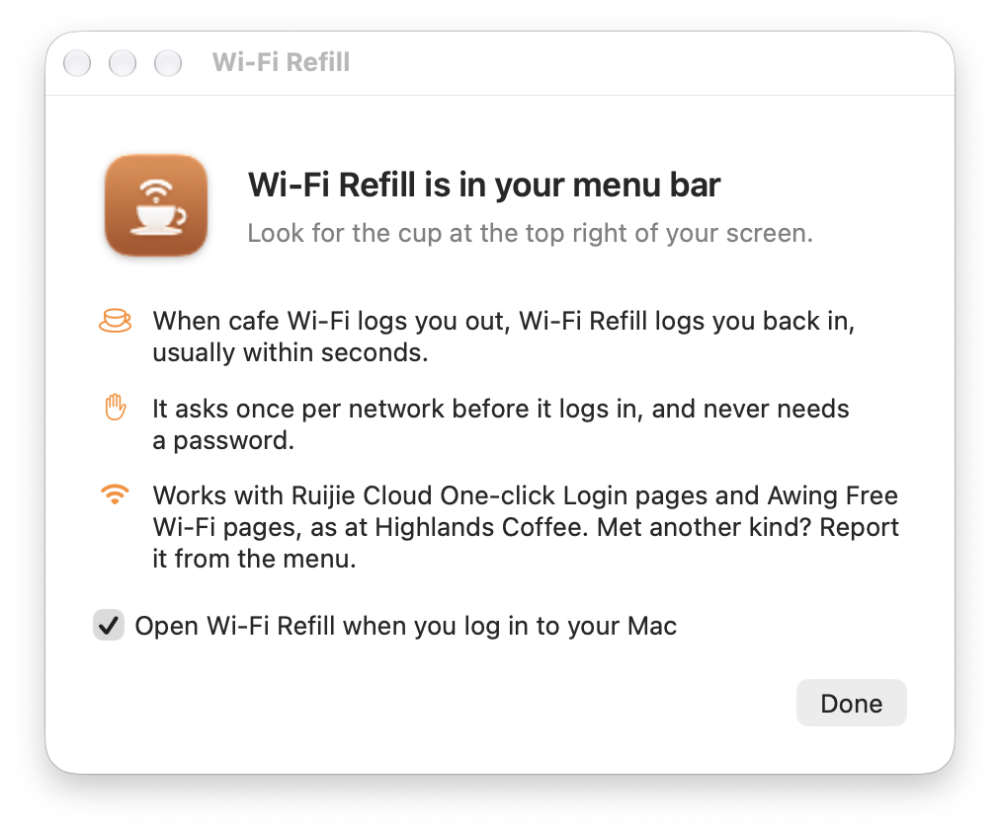

<p align="center"></p>

<h1 align="center">Wi-Fi Refill</h1>

<p align="center"><b>Free refills for cafe Wi-Fi.</b><br>
A small Mac menu bar app that logs you back in when the cafe's Wi-Fi logs you out.</p>

<p align="center">
  <a href="https://github.com/hweihwang/wifi-refill/releases/latest/download/Wi-Fi-Refill.dmg"><b>Download for macOS</b></a> ·
  <a href="https://hweihwang.com/wifi-refill/">Website</a> ·
  <a href="#install-with-homebrew">Homebrew</a> ·
  <a href="LICENSE">MIT</a>
</p>

<p align="center"></p>

Many cafes put their Wi-Fi behind a login page with a single "connect" button, and end the session after an hour.
Your Mac stays on the Wi-Fi, but nothing loads until you open a page like neverssl.com and press the button again.

Wi-Fi Refill presses it for you. It learns from the login page how long a session lasts, checks when it is due to
end, and logs you back in. On a network without a login page it looks every five minutes for the first three hours,
then stays quiet until your Mac joins another network.

- **No setup.** No accounts and no passwords. It asks once per network before it logs in.
- **Quiet.** It checks when your Mac joins a network or wakes up, when a session is due to end, and every five minutes
  on a cafe network in case the router ends it early. Other networks get the same five-minute check for three hours
  after joining, then nothing.
- **Careful.** It only presses buttons on login pages it was tested against, and it only talks to that login page's
  own servers and the cafe's router or Wi-Fi controller.

## Which login pages work

Wi-Fi Refill supports two kinds of login page:

- **Ruijie Cloud** pages with a **One-click Login** button. You will recognise them by the address
  `portal-…ruijienetworks.com` in your browser and the button at the bottom of the page. Tested on a live cafe network
  that logs you out every 60 minutes.
- **Awing** Free Wi-Fi pages on Extreme Networks Wi-Fi, as at Highlands Coffee. The address starts with
  `v1.awingconnect.vn/login`, and the page shows an advert with a connect button. These pages don't say how long a
  session lasts, so Wi-Fi Refill checks every five minutes.

Other login pages are left alone. If you meet one that only needs a button press, choose **Report This Login Page…**
in the menu. It describes how the page is built: addresses with unfamiliar names replaced, parameter and form field
names, and no values. You can read and edit it first, and GitHub opens with it filled in. Reports are how new kinds of
login pages get supported.

Login pages that ask for a voucher, a room number, a phone number or a password are out of scope.

## Install

Download [Wi-Fi-Refill.dmg](https://github.com/hweihwang/wifi-refill/releases/latest/download/Wi-Fi-Refill.dmg), open
it and drag Wi-Fi Refill to Applications. It is signed and notarized by Apple. It needs macOS 14 Sonoma or later and
runs on Apple silicon and Intel Macs.



Look for the cup in your menu bar. The first time a supported login page appears, Wi-Fi Refill asks whether it may log
in on that network, and macOS asks whether it may reach devices on your local network. Allow both: the last step of
the login is a request to the cafe's router or Wi-Fi controller.

### Install with Homebrew

```sh
brew tap hweihwang/wifi-refill
brew trust --tap hweihwang/wifi-refill
brew install --cask wifi-refill
```

Homebrew asks you to trust taps outside its own repositories; the second line does that for this one.

Wi-Fi Refill updates itself, so you never need to download it again.

## Privacy

Wi-Fi Refill has no analytics and no account. It makes these requests and no others:

| To | When | Why |
|---|---|---|
| `captive.apple.com` | When your Mac joins a network or wakes; on a cafe network when the session is due to end and every five minutes; on other networks every five minutes for three hours after joining | The same check macOS uses to notice a login page |
| The login page's own servers | When a supported login page appears | To read the page before asking you, and to log in once you agree |
| The cafe's router or Wi-Fi controller | After you agree, on that network | The last step of the login |
| `hweihwang.com` | Once a day | To look for updates |
| `github.com` | When an update downloads | The update itself |
| `github.com` | Only when you choose Open GitHub in a report | The report travels in the page address; it is published only if you submit the issue |

The first three go over the Wi-Fi or Ethernet itself, even when a VPN is on: while a login page holds the network, a
VPN can't reach anything, and the login page only exists on the cafe's network. macOS checks for login pages the same
way.

It keeps a short log at `~/Library/Logs/WiFiRefill.log` and its settings on your Mac. It never runs a login page's
scripts and never follows a login page to other websites.

## Questions

**Why does the cafe log me out?** The cafe's router gives each login a fixed time, often an hour. When it runs out,
the router sends every web request to the login page again, while your Mac still shows a working Wi-Fi connection.

**How fast is it?** Wi-Fi Refill learns the session length from the login page and checks when the session is due to
end, then every two seconds until the router ends it. If the router ends a session early, the next check comes
within five minutes, or sooner if macOS notices the change.

**What does the cup in the menu bar mean?** Filled: you are on a cafe network and logged in. Outline: nothing to do on
this network. A warning sign: the last login failed, and the menu says why.

**Can I turn it off for one network?** Yes. Open **Networks** in the menu and turn off **Log In Automatically**, or
choose **Pause** to stop everywhere.

## Build from source

You need Xcode 16 or later.

```sh
swift test                 # the login flow is replayed from a recording of a real network
scripts/install-dev.sh     # builds, signs and opens ~/Applications/Wi-Fi Refill.app
```

[CONTRIBUTING.md](CONTRIBUTING.md) explains how to add support for another login page.

## License

MIT, see [LICENSE](LICENSE). Wi-Fi Refill uses [Sparkle](https://sparkle-project.org) for updates, also under the MIT
license. It is not affiliated with Ruijie Networks, Awing, Extreme Networks or Highlands Coffee.

Made by [Hoang](https://hweihwang.com/). Found a bug? [Open an issue](https://github.com/hweihwang/wifi-refill/issues).
Security problems go to [SECURITY.md](SECURITY.md).
